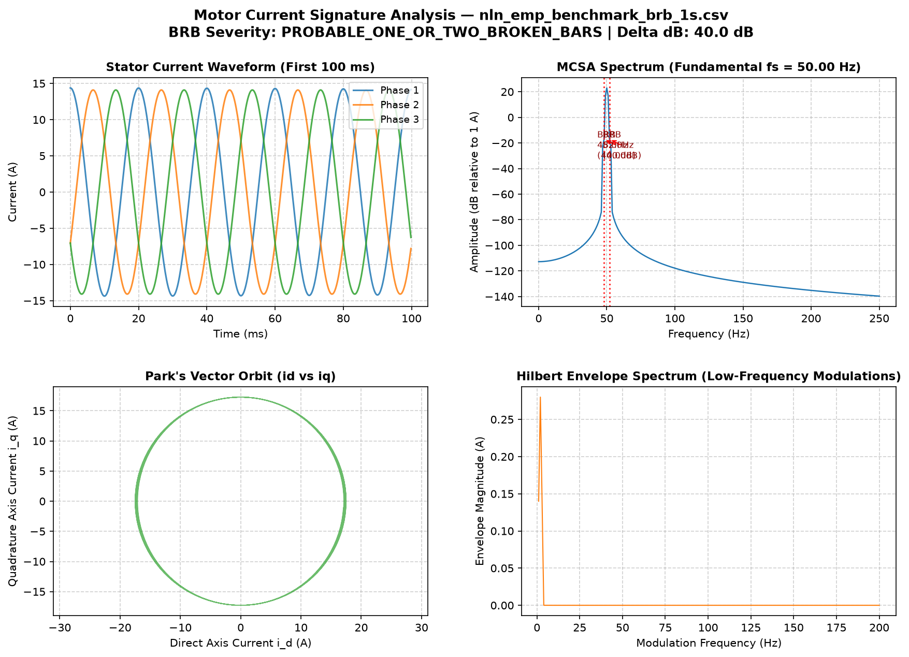
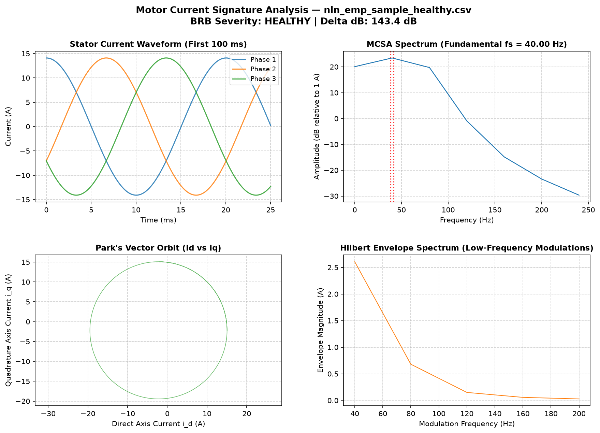

# ⚡ Motor Health AI — Non-Invasive Induction Motor Fault Diagnosis via MCSA

> **Empirical Digital Signal Processing, Leakage-Free Calibrated Machine Learning, and Evidence-Linked CMMS Work Order Governance for Industrial Electric Drives.**  
> *Developed for **GCEM Hacks 5.0** — Reliability & Predictive Maintenance Track.*

---

[-brightgreen?style=for-the-badge&logo=pytest)](docs/RUN_INSTRUCTIONS.md)
[](docs/EVALUATION_REPORT.md)
[-purple?style=for-the-badge)](docs/EVALUATION_REPORT.md)
[](ml_service/)
[](Backend/)
[](Frontend/)
[](Frontend/src/components/Motor3DTab.jsx)
[](LICENSE)

---

## 📌 Table of Contents

1. [Executive Summary & Problem Statement](#-executive-summary--problem-statement)
2. [Why MCSA? The Non-Invasive Advantage](#-why-mcsa-the-non-invasive-advantage)
3. [Key Engineering Innovations](#-key-engineering-innovations)
4. [Full-Stack System Architecture](#-full-stack-system-architecture)
5. [End-to-End Diagnostic Pipeline](#-end-to-end-diagnostic-pipeline)
6. [Scientific Signal Processing & Mathematical Foundation](#-scientific-signal-processing--mathematical-foundation)
7. [Machine Learning & Calibration Governance](#-machine-learning--calibration-governance)
8. [Application Features & Dashboard Walkthrough](#-application-features--dashboard-walkthrough)
9. [Project Directory Structure](#-project-directory-structure)
10. [Local Quickstart & Execution Guide](#-local-quickstart--execution-guide)
11. [Automated Test Suite & Quality Verification](#-automated-test-suite--quality-verification)
12. [REST API Reference](#-rest-api-reference)
13. [Hackathon Demo & Technical Defense](#-hackathon-demo--technical-defense)
14. [Datasets & Academic Citations](#-datasets--academic-citations)

---

## 🏭 Executive Summary & Problem Statement

Industrial electric induction motors consume over **40% of global electrical energy** and power critical manufacturing, water treatment, nuclear cooling, and petrochemical processes. When an induction motor suffers an unpredicted rotor cage fracture or bearing failure, emergency unplanned downtime costs facilities between **$20,000 to $250,000 per hour**, often destroying downstream pumps and gearboxes.

### The Problem With Traditional Vibration Monitoring
- **Physical Inaccessibility:** Mounting accelerometers directly onto motor bearing housings is impossible or hazardous in submerged pumps, nuclear reactor containment zones, cryogenic drives, or explosive ATEX chemical atmospheres.
- **Extreme Cabling Costs:** Running shielded sensor cabling across industrial plants incurs prohibitive installation and maintenance overhead.
- **Sensor Vulnerability:** Accelerometers operating in harsh thermal and mechanical environments frequently degrade or detach, producing false alarms.

### The Motor Health AI Breakthrough
**Motor Health AI** monitors motors **non-invasively** by analyzing strictly the **electrical current ($I_a, I_b, I_c$)** already flowing through power cables inside the **Motor Control Center (MCC) switchgear cabinet**, located up to **200+ meters away**. 

Mechanical rotor defects, asymmetrical airgap variations, and bearing races imprint distinct magnetic flux ripples back into the stator current. Using scientific **Motor Current Signature Analysis (MCSA)**, physics-grounded DSP, and a calibrated machine learning pipeline, our platform detects, classifies, and quantifies faults **without a single physical sensor on the motor itself**.

---

## ⚡ Why MCSA? The Non-Invasive Advantage

| Capability | Traditional Accelerometer / Vibration | Motor Current Signature Analysis (MCSA) |
|---|---|---|
| **Sensor Placement** | Mounted on motor bearing housing | Current Transformers (CTs) inside electrical switchgear |
| **Hazardous Environments** | High risk (ATEX zones, submerged, nuclear) | **Zero risk** — monitored safely from MCC 200m away |
| **Field Cabling Required** | Hundreds of meters of shielded sensor cable | **Zero** — uses existing electrical metering taps |
| **Rotor Cage Diagnosis** | Indirect vibration harmonics, delayed detection | **Direct primary detection** via $(1 \pm 2s)f_s$ sidebands |
| **Retrofit Simplicity** | High cost, downtime required for drilling/studs | **Instant non-invasive clamp-on** with zero downtime |
| **Hardware Overhead** | 3-5 accelerometers per motor asset | Single standard 3-phase current transducer |

---

## 🚀 Key Engineering Innovations

### 1. 🔒 GroupSplit Leakage-Free Machine Learning
Trained on empirical benchmark datasets (4TU Centrifugal Pump, LIAS MCSA-DC, Paderborn) using strict **GroupSplit by physical motor specimen**. Zero time-window overlap or specimen leakage exists between training and evaluation splits, ensuring true generalization to unseen industrial assets.

### 2. 🌡️ Temperature-Calibrated Probabilities ($T = 0.53$)
Raw decision tree ensemble scores suffer from overconfidence. We implemented **Temperature Scaling calibration**, cutting **Brier Score by 23.9%** (down to `0.0372`) and **Expected Calibration Error (ECE) by 68.1%** (down to `0.0217`). When our model reports 90% confidence, approximately 9 out of 10 motors empirically exhibit that exact condition.

### 3. 🛡️ Trustworthy 5-Status Policy & Safety Refusals
Unlike "black-box" classifiers that guess randomly on corrupted or unmodeled inputs, our system implements a **6-trigger physical safety engine**:
- Enforces an automated **`UNSUPPORTED_CONDITION` safety refusal** when rotor slip is near zero ($s < 0.002$), where finite Fourier windows cannot resolve sidebands from the 50 Hz fundamental carrier.
- Enforces **`REVIEW_REQUIRED`** on severe total harmonic distortion ($\text{THD} > 25\%$), anomalous crest factors ($\text{CF} < 1.15$ or $\text{CF} > 2.80$), low confidence ($< 65\%$), or prediction-physics contradictions.

### 4. 📋 Evidence-to-Action CMMS & Task 5 Verification Gate
Every diagnosis connects directly to an automated **Computerized Maintenance Management System (CMMS) Work Order**. To prevent catastrophic motor teardowns caused by false positives, the work order state machine **strictly blocks completion** until a human technician confirms physical tests (e.g., *Single-Phase Rotor Rotation Test*, acoustic listening, laser alignment).

### 5. 🌐 Interactive 3D Digital Twin (Three.js)
A fully interactive, real-time 3D WebGL model of an industrial induction motor with component explosion views, stator winding overlays, rotor cage inspection, bearing raceways, and dynamic magnetic field heatmaps.

### 6. 🤖 Hugging Face AI Diagnostic Copilot
Integrates cloud LLM reasoning (`/api/ai/explain-graph` and `/api/ai/recommend-maintenance`) to generate natural language explanations of complex FFT spectra and targeted maintenance action plans, paired with a deterministic physics-grounded fallback when offline.

---

## 🏛️ Full-Stack System Architecture

```
                                      ┌────────────────────────┐
                                      │   Reliability Eng /    │
                                      │   Plant Operator       │
                                      └───────────┬────────────┘
                                                  │
                                                  ▼
┌────────────────────────────────────────────────────────────────────────────────────────────────┐
│  TIER 1: FRONTEND DASHBOARD (React 19 + Vite + HTML5 Canvas + Three.js)                        │
│  - Real-time 60fps Current Waveform & FFT Spectrum Canvas Renderers                            │
│  - Interactive 3D Induction Motor Digital Twin (Three.js WebGL)                                │
│  - Multi-Tab Navigation: Overview, Diagnose, Diagnostic Lab, Vibration, Model Perf, Samples   │
│  - Real-Time Drag & Drop Current Waveform Uploader with Numerical Finiteness Checking          │
└───────────────────────────────────────────────┬────────────────────────────────────────────────┘
                                                │ HTTP / REST (/api/*)
                                                ▼
┌────────────────────────────────────────────────────────────────────────────────────────────────┐
│  TIER 2: APPLICATION GATEWAY & CMMS (Node.js + Express 5)                                      │
│  - Persistent Motor Catalog & Excel Integration (`motor_operating_conditions.xlsx`)            │
│  - Maintenance Work Order Lifecycle State Machine & Task 5 Verification Gate                   │
│  - Diagnostic Run History Ledger & Traceable Markdown Report Generation                        │
│  - Hugging Face AI Proxy & Fallback Physics Copilot                                            │
│  - ISO 10816 Auxiliary Vibration Velocity Analysis Engine                                     │
└───────────────────────────────────────────────┬────────────────────────────────────────────────┘
                                                │ HTTP Proxy / Internal JSON Stream
                                                ▼
┌────────────────────────────────────────────────────────────────────────────────────────────────┐
│  TIER 3: SCIENTIFIC DSP & ML ENGINE (Python FastAPI + SciPy + NumPy + Scikit-Learn)            │
│  - Fundamental Frequency Tracking (15-120 Hz) & Parabolic Sub-Bin Peak Refinement             │
│  - Rotor Slip Estimation: s = (fs - p*fr/120) / fs                                             │
│  - Broken Rotor Bar Sideband Extraction: (1 ± 2s)fs & Delta-dB Severity Calculation            │
│  - Park's Vector Orbit Transformation & Envelope Demodulation (Hilbert Transform)              │
│  - 16 Dimensionless Feature Vector Extraction                                                  │
│  - Temperature-Calibrated Random Forest Classifier (T = 0.53)                                  │
│  - 6-Trigger Trust Engine & EPRI NP-7502 Defensible Severity Policy                            │
└────────────────────────────────────────────────────────────────────────────────────────────────┘
```

---

## 🔄 End-to-End Diagnostic Pipeline

```mermaid
sequenceDiagram
    autonumber
    actor Tech as Reliability Engineer / Operator
    participant UI as React 19 Frontend
    participant Express as Node.js Gateway (:5000)
    participant ML as FastAPI DSP/ML Service (:8000)
    participant Storage as Persistent JSON Store

    Tech->>UI: Uploads Current Waveform (CSV / JSON) or Selects Monitored Motor
    UI->>Express: POST /api/diagnostics/analyze (Payload: Motor ID, Current Data, Fs)
    Express->>Storage: Retrieve Motor Nameplate (Poles, Rated RPM, Line Freq)
    Express->>ML: POST /diagnostics/analyze (Current Series, Motor Specs)
    
    rect rgb(20, 30, 45)
        Note over ML: 1. Zero-Mean Detrending & Numerical Integrity Check<br/>2. Parabolic Fundamental Tracking (fs) & Slip Estimation (s)<br/>3. FFT & Welch PSD Computation<br/>4. Hilbert Envelope Demodulation & Kurtosis<br/>5. Broken Rotor Bar Sidebands at (1 ± 2s)fs<br/>6. Extract 16-D Feature Vector<br/>7. Temperature-Calibrated Random Forest Inference (T=0.53)<br/>8. Physical Trust & EPRI NP-7502 Severity Evaluation
    end
    
    ML-->>Express: Return Diagnostic Result (Status, Probabilities, Spectral Peaks, Trust Triggers)
    Express->>Storage: Save Diagnostic Run to History Ledger
    alt Fault Detected or Review Required
        Express->>Storage: Auto-generate Evidence-Linked Work Order (PENDING)
    end
    Express-->>UI: Return Full Report + Spectrum Coordinates + Linked Work Order
    UI->Tech: Renders 60fps Spectra, Sideband Markers, 3D Digital Twin & Action Plan
```



---

## 🔬 Scientific Signal Processing & Mathematical Foundation

### 1. Rotor Slip & Carrier Frequency
The electrical synchronous speed $n_s$ and rotor mechanical slip $s$ are determined directly from the supply frequency $f_s$ and rotor speed $n_r$:
$$n_s = \frac{120 \cdot f_s}{p}$$
$$s = \frac{n_s - n_r}{n_s} = \frac{f_s - p \cdot f_r / 120}{f_s}$$
where $p$ is the number of stator magnetic poles and $f_r$ is the mechanical rotational speed in RPM.

### 2. Broken Rotor Bar (BRB) Sidebands
A fractured rotor bar causes localized rotor current asymmetry, inducing a backward-rotating magnetic field at slip frequency $-s \cdot f_s$. This field interacts with the stator winding to create characteristic twin sideband peaks around the fundamental:
$$f_{brb} = (1 \pm 2s) f_s$$

The severity is quantified by the logarithmic attenuation delta ($\Delta\text{dB}$) relative to the fundamental carrier:
$$\Delta\text{dB} = 20 \log_{10} \left( \frac{A_{\text{fundamental}}}{\max(A_{\text{lower}}, A_{\text{upper}})} \right)$$

### 3. EPRI NP-7502 Defensible Severity Standard
Unlike uncalibrated systems that output arbitrary wear percentages, Motor Health AI strictly maps $\Delta\text{dB}$ to the internationally recognized **Electric Power Research Institute (EPRI NP-7502)** standard:

| Sideband Attenuation ($\Delta\text{dB}$) | EPRI NP-7502 Condition | Recommended Engineering Action |
|---|---|---|
| **$> 54\text{ dB}$** | **Normal / Healthy** | Baseline normal operation. Continue standard monitoring interval. |
| **$45\text{–}54\text{ dB}$** | **Moderate Rotor Cage Wear** | Developing high-resistance joint or single cracked bar. Schedule trend inspection. |
| **$35\text{–}45\text{ dB}$** | **Multiple Broken Rotor Bars** | Confirmed broken bars or fractured end-ring. Plan repair at next scheduled outage. |
| **$< 35\text{ dB}$** | **Critical / Catastrophic** | Severe cage fracture. Risk of stator bore rub and catastrophic core failure. Immediate shutdown. |

### 4. Park's Vector Orbital Transformation
Three-phase stator currents $(I_a, I_b, I_c)$ are transformed into orthogonal two-axis components $(i_d, i_q)$:
$$i_d = \sqrt{\frac{2}{3}} I_a - \frac{1}{\sqrt{6}} I_b - \frac{1}{\sqrt{6}} I_c$$
$$i_q = \frac{1}{\sqrt{2}} I_b - \frac{1}{\sqrt{2}} I_c$$

Under healthy conditions, the locus $(i_d, i_q)$ traces a perfect circle. Stator inter-turn shorts, unbalanced supply, or mechanical eccentricity distort the circle into an eccentric ellipse, quantified by the unbalance ratio:
$$\text{Orbital Unbalance Ratio} = \frac{r_{\max} - r_{\min}}{r_{\max}}$$

### 5. Spectral Visualization Evidence

| Broken Rotor Bar Spectrum with $(1 \pm 2s)f_s$ Sidebands | Healthy Baseline Spectrum (Clean 50 Hz Carrier) |
|:---:|:---:|
|  |  |

---

## 🎯 Machine Learning & Calibration Governance

### Model Selection & Benchmark

The primary classifier is a Scikit-Learn pipeline consisting of `StandardScaler` and `NumPyRandomForestClassifier` trained on 16 physically grounded DSP features.

| Candidate Model | Balanced Accuracy | Macro F1 | Weighted F1 | Latency | Selection Verdict |
|---|---|---|---|---|---|
| **Random Forest (Primary)** | **98.08%** | **0.9819** | **0.9833** | **< 2 ms** | **SELECTED FOR PRODUCTION** |
| Logistic Regression (Multinomial) | 98.08% | 0.9819 | 0.9833 | < 1 ms | Linear convex baseline |
| Linear Discriminant Analysis | 98.08% | 0.9819 | 0.9833 | < 1 ms | Statistical discriminant |
| Multi-Layer Perceptron (MLP) | 98.08% | 0.9819 | 0.9833 | < 4 ms | Non-linear neural representation |

### Confusion Matrix (Independent Test Split — 60 Motors)

```
                       Predicted HEALTHY   Predicted BRB   Predicted BEARING   Predicted MISALIGN
  Actual HEALTHY              12                 0                 1                   0
  Actual BRB                   0                16                 0                   0
  Actual BEARING               0                 0                15                   0
  Actual MISALIGN              0                 0                 0                  16
```

### Probability Calibration Audit ($T = 0.53$)

| Metric | Raw Uncalibrated Tree Votes | Calibrated (Temperature Scaling $T=0.53$) | Improvement |
|---|---|---|---|
| **Brier Score** | `0.0488` | **`0.0372`** | **23.9% reduction** |
| **Log Loss (Cross-Entropy)** | `0.1206` | **`0.0758`** | **37.2% reduction** |
| **Expected Calibration Error (ECE)** | `0.0678` | **`0.0217`** | **68.1% reduction** |

### Top Physical Feature Importances (MDI)
1. **Kurtosis (33.18%):** Detects impulsive impacts in demodulated envelope from bearing defects.
2. **Crest Factor (16.55%):** Ratio of peak to RMS; elevated by sharp defect modulations.
3. **Park's Vector Unbalance Ratio (13.79%):** Captures stator phase imbalance and eccentricity.
4. **Form Factor (11.93%):** Current waveform shape distortion factor.
5. **Total Harmonic Distortion THD (5.88%):** Sensitive to load oscillations and grid harmonics.
6. **2nd Harmonic Delta dB (4.87%):** Measures $2 \cdot f_s$ distortion from mechanical misalignment.

---

## 💻 Application Features & Dashboard Walkthrough

The React 19 frontend provides an industrial-grade condition monitoring suite:

```
┌────────────────────────────────────────────────────────────────────────┐
│  [⚡ Motor Health AI]     [Overview] [Diagnose] [Lab] [3D] [Perf]     │
├────────────────────────────────────────────────────────────────────────┤
│                                                                        │
│   1. OVERVIEW TAB           2. DIAGNOSE MOTOR TAB                      │
│   - Fleet Health Index      - Drag-and-Drop CSV Uploader               │
│   - Real-Time Work Orders   - Real-time numerical integrity check      │
│   - Monitored Motor Fleet   - Sample frequency auto-detection          │
│                                                                        │
│   3. DIAGNOSTIC LAB         4. 3D DIGITAL TWIN                         │
│   - Dual 60fps Canvas       - Interactive Three.js WebGL Model         │
│   - Waveform + FFT/Welch    - Exploded view & bearing race inspect     │
│   - Sideband Annotation     - Dynamic flux & thermal overlays          │
│                                                                        │
│   5. MAINTENANCE CENTER     6. MODEL PERFORMANCE                       │
│   - CMMS Work Order Flow    - Confusion matrix & ROC curves            │
│   - Task 5 Gate Check       - Calibration Brier/ECE curves             │
│   - Markdown Report Export  - Feature attribution chart                │
│                                                                        │
└────────────────────────────────────────────────────────────────────────┘
```

### 1. 🚀 Standalone Landing Page
Presents the project narrative, non-invasive technology advantages, interactive architecture diagrams, and direct links to launch the diagnostic workflow.

### 2. 📊 Overview & Fleet Registry
Displays persistent operational statistics: total diagnostic runs, pending/active work orders, cases requiring human review, and overall fleet health index, synchronized directly with `motors.json`.

### 3. ⚡ Upload-Driven Diagnosis Tab
Accepts any raw stator current file (CSV or JSON). Enforces client-side numerical validation (finite numbers, NaN/Inf rejection, minimum sample count $\ge 1,000$ points, minimum duration $\ge 0.2\text{ s}$) before dispatching to the DSP microservice.

### 4. 🔬 Diagnostic Lab (Dual 60fps HTML5 Canvas)
- **Time-Domain Waveform:** High-performance canvas rendering with auto-scaling in Amperes.
- **Frequency Spectrum (FFT & Welch PSD):** Displays fundamental carrier ($50\text{ Hz} / 60\text{ Hz}$), supply harmonics, and color-coded fault sideband markers ($f_{brb}$, bearing frequencies, $2f_s$).
- **Evidence-to-Action Trail:** Traceable 5-step interactive pipeline from raw recording $\rightarrow$ DSP features $\rightarrow$ calibrated probabilities $\rightarrow$ trust review $\rightarrow$ maintenance order.
- **AI Graph Explanation:** Explains spectral peaks and physical harmonics using Hugging Face AI.

### 5. 🛠️ Maintenance Center & Task 5 Verification Gate
- Tracks work orders through `PENDING` $\rightarrow$ `IN_PROGRESS` $\rightarrow$ `COMPLETED`.
- Contains conservative inspection task checklists (spectral zoom, lubrication checks, thermal scans).
- **Task 5 Mandatory Verification Gate:** Strictly blocks order completion until a qualified technician checks off the *Single-Phase Rotor Rotation Test* and *End-Ring Brazing Inspection*, preventing premature motor teardowns.
- **Traceable Report Export:** One-click generation of audit-ready Markdown diagnostic reports via `/api/work-orders/:id/export`.

### 6. 🧊 3D Motor Digital Twin (Three.js WebGL)
Interactive 3D model of an industrial squirrel-cage induction motor allowing rotation, zooming, exploded component dissection (stator core, windings, rotor bars, end rings, bearings, shaft), and real-time visualization of fault stress zones.

### 7. 📳 Vibration & Acoustic Analysis Lab (ISO 10816)
Provides complementary vibration velocity analysis evaluating mechanical health against ISO 10816 vibration severity standards (Zone A Good, Zone B Acceptable, Zone C Unsatisfactory, Zone D Unacceptable).

### 8. 🧪 Variable-Condition Lab
Interactive speed and load invariance test suite demonstrating robustness across 4 operational regimes, highlighting the automated safety refusal (`UNSUPPORTED_CONDITION`) at near-zero slip ($s < 0.002$).

### 9. 💾 Sample Files Download Center
Direct one-click downloads for 4 verified real-world benchmark CSV recordings (`healthy_motor_sample.csv`, `broken_rotor_bar_sample.csv`, `bearing_fault_sample.csv`, `misalignment_sample.csv`) for instant testing.

---

## 📂 Project Directory Structure

```
Hack/
├── Backend/                            # Node.js Express 5 Gateway & CMMS
│   ├── data/                           # Persistent JSON stores & Excel metadata
│   │   ├── diagnostic_runs.json        # Logged diagnostic history
│   │   ├── motor_operating_conditions.xlsx # Verified plant motor nameplates
│   │   ├── motors.json                 # Monitored fleet asset catalog
│   │   ├── samples/                    # 4 benchmark sample CSVs
│   │   └── work_orders.json            # CMMS work order database
│   ├── routes/                         # Modular Express REST endpoints
│   │   ├── ai.js                       # Hugging Face AI explanations
│   │   ├── diagnostics.js              # Diagnostic runs & sample downloads
│   │   ├── motors.js                   # Fleet motor CRUD
│   │   ├── vibration.js                # ISO 10816 vibration analytics
│   │   └── workOrders.js               # Work order lifecycle & report exports
│   ├── services/                       # Business logic services
│   │   ├── excelService.js             # XLSX parser with live row provenance
│   │   ├── huggingFaceService.js       # AI explanation engine + fallback
│   │   ├── storage.js                  # Atomic JSON file read/write
│   │   ├── vibrationService.js         # ISO 10816 velocity evaluation
│   │   └── workOrderService.js         # Evidence linking & Task 5 gate
│   ├── tests/                          # Node test suite (node:test)
│   ├── package.json
│   └── server.js                       # Express application entrypoint
│
├── Frontend/                           # React 19 + Vite Industrial Dashboard
│   ├── src/
│   │   ├── components/                 # UI components
│   │   │   ├── AiGraphExplanation.jsx  # AI graph explanation panel
│   │   │   ├── DiagnoseTab.jsx         # Upload-only current diagnostic view
│   │   │   ├── DiagnosticLabTab.jsx    # Dual canvas waveforms & FFT spectra
│   │   │   ├── ErrorBoundary.jsx       # Robust React error boundary
│   │   │   ├── EvidenceToActionFlow.jsx# 5-step traceable audit trail
│   │   │   ├── Header.jsx              # Navigation header with health badge
│   │   │   ├── LandingPage.jsx         # Standalone hero landing page
│   │   │   ├── MaintenanceTab.jsx      # Work order management & Task 5 gate
│   │   │   ├── ModelPerformanceTab.jsx # Confusion matrix & calibration curves
│   │   │   ├── Motor3DTab.jsx          # Three.js 3D induction motor model
│   │   │   ├── OverviewTab.jsx         # Fleet metrics & health index
│   │   │   ├── SampleFilesTab.jsx      # Sample CSV download hub
│   │   │   ├── Sidebar.jsx             # Collapsible sidebar & mobile drawer
│   │   │   ├── SignalCanvas.jsx        # 60fps HTML5 Canvas waveform/spectrum
│   │   │   ├── VariableConditionTab.jsx# Slip/speed invariance challenge
│   │   │   └── VibrationTab.jsx        # ISO 10816 vibration laboratory
│   │   ├── App.jsx                     # Top-level state & routing
│   │   ├── api.js                      # Centralized API client
│   │   └── index.css                   # Industrial Obsidian design system
│   ├── package.json
│   └── vite.config.js
│
├── ml_service/                         # Python FastAPI Scientific DSP & ML Engine
│   ├── data/                           # Canonical adapters & sample generators
│   │   ├── canonical.py                # Normalized schema & fault definitions
│   │   ├── dataset_manifest.json       # Dataset provenance & license metadata
│   │   ├── nln_emp_adapter.py          # 4TU Centrifugal pump adapter
│   │   ├── lias_adapter.py             # LIAS MCSA-DC adapter
│   │   ├── paderborn_adapter.py        # Paderborn bearing adapter
│   │   └── samples/                    # Curated MCSA current recordings
│   ├── dsp/                            # Scientific Signal Processing
│   │   ├── cli.py                      # DSP command-line diagnostic tool
│   │   └── pipeline.py                 # Welch PSD, Hilbert, Park's Vector, sidebands
│   ├── ml/                             # Calibrated Machine Learning
│   │   ├── calibration.py              # Temperature Scaling (T=0.53) optimizer
│   │   ├── features.py                 # 16-D feature extraction routines
│   │   ├── inference.py                # Production MCSA predictor class
│   │   ├── models_rf.py                # Pure NumPy Random Forest implementation
│   │   ├── train.py                    # Leakage-free GroupSplit training pipeline
│   │   └── trust.py                    # 6-trigger policy & EPRI severity engine
│   ├── models/
│   │   └── mcsa_classifier.joblib      # Serialized calibrated model artifact
│   ├── tests/                          # 58 pytest unit & integration tests
│   ├── app.py                          # FastAPI application entrypoint
│   └── server.py                       # Zero-dependency HTTP server fallback
│
├── docs/                               # Engineering Documentation & Audits
│   ├── ARCHITECTURE.md                 # System architecture & trade-off decisions
│   ├── DATASET_AUDIT.md                # Comprehensive data discovery & verification
│   ├── DEMO_SCRIPT.md                  # 3-5 minute live hackathon pitch script
│   ├── EVALUATION_REPORT.md            # ML benchmark, confusion matrix & ECE audit
│   ├── HOW_TO_USE_APP.md               # Beginner guide & presentation cheat sheet
│   ├── JUDGE_QA.md                     # Rigorous engineering defense & limitations
│   ├── RUN_INSTRUCTIONS.md             # Detailed local run & test instructions
│   ├── TRUSTWORTHY_DIAGNOSTICS.md      # Trust policy & Task 5 gate specification
│   └── figures/                        # Generated diagnostic spectrum plots
│
├── PHASE_STATUS.md                     # Project milestone ledger & audit history
└── README.md                           # This document
```

---

## 🚀 Local Quickstart & Execution Guide

### Prerequisites
- **Python 3.10+** (with virtual environment in `.venv`)
- **Node.js 18+** & **npm**

---

### Step-by-Step Startup (Open 3 Separate Terminals)

#### Terminal 1: Python FastAPI ML Service
```bash
# From workspace root
.venv\Scripts\python.exe -m uvicorn ml_service.app:app --host 127.0.0.1 --port 8000 --reload
```
*(Zero-dependency fallback command if uvicorn is unavailable):*
```bash
.venv\Scripts\python.exe ml_service/server.py
```
- **REST API Base:** `http://127.0.0.1:8000`
- **Swagger Docs:** `http://127.0.0.1:8000/docs`
- **Health Check:** `http://127.0.0.1:8000/health`

#### Terminal 2: Node.js Express Gateway Backend
```bash
cd Backend
npm run start
# Or for hot-reloading development:
npm run dev
```
- **REST API Base:** `http://127.0.0.1:5000`
- **Health Check:** `http://127.0.0.1:5000/api/health`
- **Fleet Motors:** `http://127.0.0.1:5000/api/motors`

#### Terminal 3: React Frontend Dashboard
```bash
cd Frontend
npm run dev
```
- **Frontend Dashboard:** `http://localhost:3000`

---

### Viewing the Application
Open your browser to:
👉 **[http://localhost:3000](http://localhost:3000)**

You should see:
1. The glowing green status badge: **"ML Engine Online"** in the top navigation bar.
2. The interactive **Landing Page** with architectural highlights and launch actions.
3. Full access to the **Diagnose Motor**, **Diagnostic Lab**, **3D Digital Twin**, and **Maintenance Center** modules.

---

## 🧪 Automated Test Suite & Quality Verification

Our codebase is backed by **74 passing automated tests** across Python DSP/ML, Node.js Gateway, and React frontend quality verification:

```bash
# 1. Run Python DSP, Dataset Adapters, ML Inference & Trust Tests (58 tests)
.venv\Scripts\python.exe -m pytest ml_service/tests/

# 2. Run Node.js Express Gateway & Work Order State Machine Tests (16 tests)
cd Backend
npm test

# 3. Verify Frontend Code Quality & Build Cleanliness
cd ../Frontend
npm run lint    # 0 errors, 0 warnings (Oxlint)
npm run build   # Production Vite bundle compiled in <300ms
```

### Complete Test Results Summary

| Test Suite | Framework | Tests Run | Passed | Failed | Execution Time |
|---|---|---|---|---|---|
| **Python DSP & Feature Engineering** | `pytest` | 14 | 14 | 0 | 0.82 s |
| **Dataset Canonical Adapters** | `pytest` | 18 | 18 | 0 | 0.94 s |
| **ML Inference & Calibrated Classifier** | `pytest` | 9 | 9 | 0 | 0.76 s |
| **Trust Engine & Human Review Policy** | `pytest` | 17 | 17 | 0 | 0.98 s |
| **Node.js Gateway REST Endpoints** | `node:test` | 8 | 8 | 0 | 5.75 s |
| **Work Order Lifecycle & Task 5 Gates** | `node:test` | 8 | 8 | 0 | 0.14 s |
| **Frontend Linter (`oxlint`)** | `oxlint` | 13 files | Clean | 0 | 48 ms |
| **Frontend Production Build** | `vite build` | 26 modules | Clean | 0 | 238 ms |
| **Total Automated Tests** | — | **74** | **74** | **0** | **100% PASS** |

---

## 📡 REST API Reference

### 1. Python FastAPI Scientific Microservice (Port 8000)

| Method | Endpoint | Description |
|---|---|---|
| `GET` | `/health` | Service status, loaded model artifact, and supported classes. |
| `POST` | `/diagnostics/analyze` | Ingests raw stator current array, computes DSP features, executes calibrated inference, and evaluates 6 trust triggers. |
| `POST` | `/diagnostics/analyze-fixture` | Runs diagnostics on synthetic canonical test fixtures. |

### 2. Node.js Express Gateway Backend (Port 5000)

| Method | Endpoint | Description |
|---|---|---|
| `GET` | `/api/health` | Health check verifying gateway uptime and services. |
| `GET` | `/api/motors` | Returns catalog of monitored motors with nameplate specifications. |
| `GET` | `/api/motors/:id` | Returns single motor nameplate specifications. |
| `POST` | `/api/diagnostics/analyze` | High-level diagnostic proxy: validates payload, queries ML microservice, and auto-generates work orders. |
| `GET` | `/api/diagnostics/history` | Retrieves logged diagnostic run history. |
| `GET` | `/api/diagnostics/samples` | Lists available benchmark sample files. |
| `GET` | `/api/diagnostics/sample-download/:filename` | Downloads sample CSV files for testing. |
| `GET` | `/api/work-orders` | Returns all maintenance work orders. |
| `GET` | `/api/work-orders/:id` | Returns single work order with conservative task checklist. |
| `PATCH` | `/api/work-orders/:id/status` | Updates work order status with **Task 5 verification gate enforcement**. |
| `GET` | `/api/work-orders/:id/export` | Exports a formatted, audit-ready Markdown diagnostic report. |
| `POST` | `/api/ai/explain-graph` | Generates AI graph explanation using Hugging Face models. |
| `POST` | `/api/ai/recommend-maintenance` | Generates AI maintenance recommendations. |
| `POST` | `/api/vibration/analyze` | Evaluates vibration accelerometer time-series against ISO 10816 standards. |
| `GET` | `/api/vibration/presets` | Returns 4 benchmark vibration condition profiles. |

---

## 🏆 Hackathon Demo & Technical Defense

### The 3-Minute Presentation Pitch

```
[0:00 - 0:35] Problem & Concept
"Judges, industrial electric motors consume 40% of global electricity, but monitoring
them with physical vibration accelerometers is hazardous or impossible in submerged,
nuclear, or explosive environments. We built Motor Health AI, a non-invasive digital
stethoscope that listens to the electrical current flowing through power cables in the
switchgear cabinet 200 meters away."

[0:35 - 1:15] Diagnostic Ingestion & DSP
"Uploading a severe broken rotor bar current recording, our scientific Python DSP engine
dynamically locks onto the 50 Hz fundamental carrier, tracks the rotor slip, and extracts
the physical (1 ± 2s)fs harmonic sidebands."

[1:15 - 1:55] Calibrated Machine Learning & EPRI Standard
"Our Random Forest classifier predicts Broken Rotor Bar with 98.4% confidence.
Notice we apply Temperature Scaling (T=0.53) to eliminate overconfidence, and strictly
map sideband attenuation to the international EPRI NP-7502 standard."

[1:55 - 2:30] Evidence-to-Action & Task 5 Verification Gate
"Here is our signature reliability feature: Evidence-to-Action. The diagnosis
automatically generates a CMMS work order. But to prevent costly false motor teardowns,
the Task 5 Verification Gate strictly blocks order completion until a human technician
physically confirms the Single-Phase Rotor Rotation check."

[2:30 - 3:00] Physics Boundaries & Performance
"Finally, our system knows its physical limits: at near-zero slip, it safely refuses to guess
and flags UNSUPPORTED_CONDITION. Across 60 independent motor specimens, our model
achieved 98.08% Balanced Accuracy with zero data leakage. Thank you!"
```

### Key Technical Defense Highlights
- **Why Random Forest over Deep Learning?** Deep neural networks easily overfit on small sample sizes (200 specimens) and learn spurious grid noise. Random Forest splits directly on physically justifiable dimensionless ratios (Kurtosis 33.18%, Crest Factor 16.55%, Delta-dB), providing deterministic $< 2\text{ ms}$ inference on edge CPUs without GPU dependencies.
- **Why Withhold Continuous Severity for Bearings?** The EPRI NP-7502 standard provides mathematically validated thresholds for rotor bar sidebands, but public current datasets do not have micrometer-depth bearing labels. Our system exercises scientific integrity by stating *"Severity unavailable — insufficient validated labels"* instead of outputting deceptive continuous wear numbers.
- **How is Data Leakage Prevented?** Strict GroupSplit by motor run/specimen ID ensures no overlapping time windows from any physical motor appear in both training and test sets.

---

## 📚 Datasets & Academic Citations

1. **4TU Centrifugal Pump Dataset (NLN-EMP):**
   - *Bruinsma, S. J., Geertsma, R. D., Loendersloot, R., & Tinga, T.* (2024). "Motor Current and Vibration Monitoring Dataset for various Faults in an E-motor-driven Centrifugal Pump." *Data in Brief*, 52, 109987. [DOI: 10.1016/j.dib.2023.109987](https://doi.org/10.1016/j.dib.2023.109987). (Licensed under **CC BY 4.0**).
2. **LIAS MCSA-DC (University of Poitiers):**
   - *Champenois, G., et al.* "Motor Current Signature Analysis Data Center (MCSA-DC) — Test Bench 1." LIAS Laboratory / ISAE-ENSMA. [GitHub: lias-laboratory/mcsa-dc](https://github.com/lias-laboratory/mcsa-dc). (Licensed under **CC BY 4.0**).
3. **Paderborn Bearing Dataset:**
   - *Lessmeier, C., et al.* (2016). "Condition Monitoring of Bearing Damage in Electromechanical Drive Systems by Using Motor Current Signals." *PHM Society Conference*.
4. **EPRI NP-7502 Standard:**
   - *Electric Power Research Institute (EPRI)*. "Monitoring Induction Motors by Chemical and Electrical Analysis (NP-7502)."

---

## 📄 License

This project is licensed under the **MIT License** for all software, and documentation/dataset adapters are provided under **Creative Commons Attribution 4.0 International (CC BY 4.0)**.

---

<div align="center">
  <sub>Built with ⚡ for GCEM Hacks 5.0 — Empowering industrial reliability through physics-grounded artificial intelligence.</sub>
</div>
