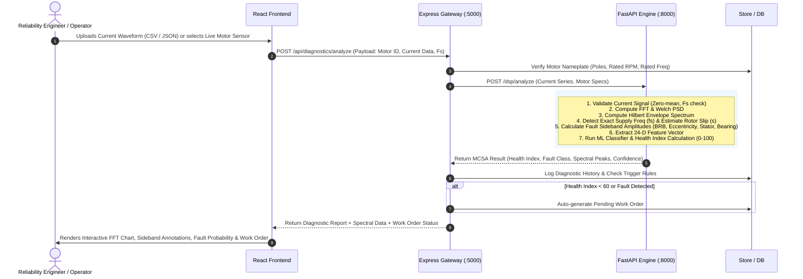

# Motor Health AI — Architecture Specification
## Induction Motor Fault Diagnosis Using Motor Current Signature Analysis (MCSA)

---

## 1. Executive Architectural Decision & Trade-Off Analysis

### 1.1 Context & Problem Statement
The project repository provides an initialized React 19 frontend (Vite) and a Node.js/Express backend (`server.js`) with an `/api/health` route. Motor Current Signature Analysis (MCSA) requires high-frequency time-series current signal ingestion (e.g., 5 kHz to 20 kHz sampling rates), computationally intensive Digital Signal Processing (DSP) including Welch power spectral density, Fast Fourier Transforms (FFT), Hilbert transform envelope demodulation, harmonic/sideband tracking, and machine learning inference (feature extraction, random forest / gradient boosting classification, and SHAP explainability).

### 1.2 Evaluation of Architectural Options

| Criterion | Option A: Express Gateway + Python ML/DSP Microservice (Recommended) | Option B: Full Migration to FastAPI (Single Backend) | Option C: Pure Node.js Backend (DSP in JS) |
|---|---|---|---|
| **Preservation of Existing Code** | **High**: Preserves existing `Backend/` Express app and configuration untouched. | **Low**: Requires discarding/replacing the Node.js setup initialized in the repository. | **High**: Preserves Node.js runtime entirely. |
| **Scientific DSP Maturity** | **High**: Direct access to `scipy.signal` (Welch, Hilbert, Butter, Find_Peaks) and `numpy`. | **High**: Direct access to Python scientific ecosystem. | **Very Low**: JavaScript lacks validated, performant DSP packages for Hilbert demodulation and harmonic sideband analysis. |
| **Separation of Concerns** | **High**: Express handles motor metadata, work orders, telemetry persistence; Python handles mathematical DSP and ML inference. | **Medium**: Single process mixes I/O-bound CRUD with CPU-bound numerical computations. | **Low**: CPU-bound FFT blocks Node.js event loop unless worker threads are engineered. |
| **Developer Ergonomics & Hackathon Velocity** | **High**: Express and FastAPI both provide fast prototyping; endpoints are decoupled and independently testable. | **Medium**: Requires porting or discarding existing Express code and environment. | **Very Low**: High risk of mathematical bugs when implementing custom DSP routines in JS. |
| **IPC / Latency Overhead** | **Low-to-Medium**: Local HTTP/JSON streaming between Express and Python on `localhost` (~2-5ms overhead for downsampled spectra). | **None**: In-process execution. | **None**: In-process execution. |

### 1.3 Architectural Decision
**We adopt Option A:**
1. **Preserve Express** (`Backend/`, port 5000) as the **Application & Gateway Server**, responsible for:
   - Motor fleet registry and operational metadata (nameplate specifications: rated kW, poles, rated RPM, synchronous frequency, supply voltage).
   - Maintenance work order management (creation, assignment, status tracking, repair history).
   - Alert notifications and audit logging.
   - API proxying / aggregation for frontend consumers.
2. **Introduce FastAPI** (`ml_service/`, port 8000) as the **Scientific DSP & MCSA Diagnostic Engine**, responsible for:
   - Stator current waveform ingestion and validation (sampling rate, duration, single-phase or 3-phase $I_a, I_b, I_c$).
   - DSP pipeline: Fundamental frequency extraction ($f_s$), bandpass/notch filtering, Welch PSD, FFT magnitude/phase, Hilbert envelope demodulation.
   - Sideband & harmonic search: Slip estimation ($s = \frac{f_s - p \cdot f_r / 120}{f_s}$), Broken Rotor Bar (BRB) sidebands ($f_{brb} = (1 \pm 2s)f_s$), eccentricity sidebands ($f_s \pm f_r$), and bearing defect frequencies ($|f_s \pm m \cdot f_v|$).
   - Machine Learning Classification: Statistical & spectral feature extraction fed into a trained classifier (Healthy, Broken Rotor Bar, Stator Winding Inter-turn Short, Bearing Degradation, Dynamic/Static Eccentricity).
   - Model Explainability: Feature attribution and physical peak-to-dB delta verification.

---

## 2. High-Level Component Architecture

```mermaid
graph TB
    subgraph Client_Layer ["Client Layer (Port 5173)"]
        UI["React 19 Dashboard (Vite)"]
        Components["Components: Motor Overview, Live Waveform, Spectrum FFT/Welch, Fault Radar, Work Orders"]
        ClientAPI["API Client (Axios / Fetch)"]
        UI --> Components
        Components --> ClientAPI
    end

    subgraph Gateway_Layer ["Application & Gateway Service (Express, Port 5000)"]
        ExpressApp["Express Server (server.js)"]
        HealthRoute["/api/health"]
        MotorsRoute["/api/motors (CRUD & Specs)"]
        OrdersRoute["/api/work-orders (Maintenance Orders)"]
        DiagProxy["/api/diagnostics (Proxy to ML Service)"]
        Storage["JSON / SQLite Data Store"]
        
        ExpressApp --> HealthRoute
        ExpressApp --> MotorsRoute
        ExpressApp --> OrdersRoute
        ExpressApp --> DiagProxy
        MotorsRoute --> Storage
        OrdersRoute --> Storage
    end

    subgraph Scientific_ML_Layer ["Scientific DSP & Diagnostic Engine (FastAPI, Port 8000)"]
        FastAPIApp["FastAPI Service"]
        DSPModule["DSP Pipeline (SciPy, NumPy)"]
        FeatureEngine["Feature Extractor (Time + Spectral + Demodulation)"]
        ModelInference["ML Fault Classifier (Scikit-Learn / XGBoost)"]
        Explainability["Explainability & Peak Annotation Engine"]
        
        FastAPIApp --> DSPModule
        DSPModule --> FeatureEngine
        FeatureEngine --> ModelInference
        ModelInference --> Explainability
    end

    ClientAPI -->|HTTP REST| ExpressApp
    ClientAPI -.->|Direct Heavy Stream (Optional)| FastAPIApp
    DiagProxy -->|Internal REST| FastAPIApp
```

---

## 3. End-to-End Data Flow



---

## 4. Scientific Signal Processing (DSP) & Diagnostic Pipeline

### 4.1 Strict Physical Constraint
> **Permanent Rule Compliance:** The diagnostic engine relies **strictly on electrical current signatures ($I_a, I_b, I_c$)**. Vibration, acoustic, or external voltage sensors are **never used as model inputs**.

### 4.2 MCSA Mathematical Formulations
1. **Supply Fundamental Identification ($f_s$):**
   - High-resolution FFT peak location in the range $[45, 65]\text{ Hz}$.
2. **Rotor Slip ($s$):**
   $$s = \frac{f_s - \frac{p \cdot n_r}{120}}{f_s}$$
   where $p$ is motor pole count, $n_r$ is measured/estimated rotational speed (RPM).
3. **Broken Rotor Bar (BRB) Fault Frequencies ($f_{brb}$):**
   $$f_{brb} = (1 \pm 2ks) f_s, \quad k = 1, 2, 3$$
   - The primary left sideband $f_{brb,-} = (1 - 2s)f_s$ and right sideband $f_{brb,+} = (1 + 2s)f_s$.
   - **Severity Metric:** Amplitude difference $\Delta \text{dB} = \text{Peak}(f_s)_{\text{dB}} - \text{Peak}(f_{brb})_{\text{dB}}$.
     - $\Delta \text{dB} > 54\text{ dB}$: Healthy
     - $45\text{ dB} \le \Delta \text{dB} \le 54\text{ dB}$: Early stage degradation / 1 cracked bar
     - $\Delta \text{dB} < 40\text{ dB}$: Multiple broken rotor bars (Critical)
4. **Stator Inter-Turn Short Fault ($f_{stator}$):**
   $$f_{stator} = f_s \left[ \frac{k}{p}(1-s) \pm \nu \right]$$
5. **Airgap Eccentricity Faults ($f_{ecc}$):**
   $$f_{ecc} = f_s \pm k \cdot f_r = f_s \pm k \frac{(1-s)f_s}{p}$$
6. **Bearing Defect Frequencies on Stator Current ($f_{bearing}$):**
   Modulation of the stator-rotor airgap permeance yields sidebands around fundamental:
   $$f_{bearing} = |f_s \pm m \cdot f_{v}|, \quad m = 1, 2, \dots$$
   where $f_v \in \{\text{BPFO}, \text{BPFI}, \text{BSF}, \text{FTF}\}$.
7. **Hilbert Demodulation (Envelope Analysis):**
   $$\tilde{i}(t) = \mathcal{H}\{i(t)\}, \quad a(t) = \sqrt{i^2(t) + \tilde{i}^2(t)}$$
   The FFT of the envelope $a(t)$ exposes low-frequency modulations directly without fundamental masking.

---

## 5. API Contracts & Specifications

### 5.1 Express Backend Gateway (`http://localhost:5000`)

#### `GET /api/health`
- **Description:** System health check.
- **Response:**
  ```json
  {
    "status": "OK",
    "service": "MotorHealthAI-Gateway",
    "version": "1.0.0",
    "ml_service_connected": true
  }
  ```

#### `GET /api/motors`
- **Description:** List all registered induction motors in the facility.
- **Response:** Array of motor objects containing:
  - `id`: string (e.g. `"MTR-001"`)
  - `name`: string
  - `location`: string
  - `ratedPowerKw`: number
  - `poles`: integer (e.g. 4)
  - `ratedRpm`: number (e.g. 1470)
  - `nominalCurrentA`: number
  - `supplyFreqHz`: number (e.g. 50.0)
  - `healthScore`: number (0-100)
  - `status`: `"HEALTHY" | "MONITOR" | "WARNING" | "CRITICAL"`

#### `POST /api/diagnostics/analyze`
- **Description:** Submits current signal for full MCSA DSP & ML diagnosis.
- **Request Body:**
  ```json
  {
    "motorId": "MTR-001",
    "samplingRate": 5000,
    "currentSamples": [1.42, 1.45, 1.48, "..."],
    "operatingRpm": 1475.0,
    "loadPercentage": 85.0
  }
  ```
- **Response:** See Section 5.2 `/dsp/analyze`.

#### `GET /api/work-orders`
- **Description:** Retrieve maintenance work orders.
- **Query Params:** `motorId`, `status`, `severity`

#### `POST /api/work-orders`
- **Description:** Create or update a work order (e.g., stator rewinding, rotor replacement).

---

### 5.2 Scientific ML Service (`http://localhost:8000`)

#### `POST /dsp/analyze`
- **Request Body:**
  ```json
  {
    "current_signal": [1.42, 1.45, "..."],
    "sampling_rate": 5000,
    "poles": 4,
    "rated_rpm": 1470,
    "operating_rpm": 1472,
    "supply_freq_nominal": 50.0
  }
  ```
- **Response:**
  ```json
  {
    "motor_metrics": {
      "detected_supply_freq": 50.02,
      "calculated_slip": 0.0187,
      "rms_current": 12.45,
      "crest_factor": 1.44,
      "thd_percentage": 2.15
    },
    "diagnosis": {
      "predicted_class": "Broken Rotor Bar",
      "fault_code": "FAULT_BRB_MODERATE",
      "confidence": 0.942,
      "health_index": 52.4,
      "severity": "WARNING",
      "recommended_action": "Schedule rotor inspection within 14 operating days."
    },
    "sidebands": [
      {
        "type": "BRB_LEFT",
        "frequency_hz": 48.13,
        "amplitude_db": -46.2,
        "delta_to_fundamental_db": 46.2,
        "alarm_state": "WARNING"
      },
      {
        "type": "BRB_RIGHT",
        "frequency_hz": 51.91,
        "amplitude_db": -47.1,
        "delta_to_fundamental_db": 47.1,
        "alarm_state": "WARNING"
      }
    ],
    "spectrum": {
      "frequencies": [0.0, 0.5, 1.0, "..."],
      "magnitudes_db": [-80.2, -78.1, "..."],
      "envelope_frequencies": [0.0, 1.0, "..."],
      "envelope_magnitudes": [0.01, 0.02, "..."]
    },
    "features": {
      "brb_sideband_energy": 0.084,
      "stator_harmonic_energy": 0.012,
      "bearing_demod_energy": 0.005,
      "spectral_kurtosis": 4.12
    }
  }
  ```

---

## 6. Directory Structure & Organization

```
Hack/
├── .gitignore                    # Preserved & updated with Python, ML, raw data rules
├── README.md                     # Top-level documentation
├── PHASE_STATUS.md               # Continuous audit & progress ledger
├── docs/
│   ├── ARCHITECTURE.md           # System architecture, data flow, API contracts
│   └── IMPLEMENTATION_PLAN.md   # Judging criteria mapping & phased milestones
├── Backend/                      # Node.js Express Gateway (Port 5000)
│   ├── .env.example
│   ├── package.json
│   ├── package-lock.json
│   ├── server.js                 # Gateway entry point & routes
│   └── routes/                   # Motors, Work Orders, Diagnostics routes
├── ml_service/                   # Python Scientific DSP & ML Engine (Port 8000)
│   ├── requirements.txt
│   ├── main.py                   # FastAPI server
│   ├── dsp/                      # Signal processing: FFT, Welch, Hilbert, Sidebands
│   ├── ml/                       # Classifier, feature extractor, model training/inference
│   ├── models/                   # Serialized model weights (scikit-learn / ONNX)
│   └── tests/                    # Scientific unit & DSP fixture tests
└── Frontend/                     # React 19 Frontend (Port 5173)
    ├── package.json
    ├── vite.config.js
    ├── index.html
    └── src/
        ├── App.jsx               # Dashboard layout
        ├── components/           # Spectrum chart, Motor card, Diagnosis alert, Work order modal
        └── services/             # API client services
```

---

## 7. Security, Reliability & Compliance Safeguards
1. **Zero Fake Diagnoses:** The inference engine strictly executes mathematical feature extraction and trained scikit-learn model inference. If signal SNR is insufficient or inputs are malformed, it returns explicit `SIGNAL_QUALITY_DEGRADED` errors rather than synthetic guesses.
2. **Current-Only Integrity:** API schemas accept exclusively current measurements ($I_1, I_2, I_3$). Any vibration or auxiliary voltage sensor fields are strictly rejected.
3. **Reproducibility:** All DSP calculations (window sizes, FFT bins, sampling frequencies) are parameterized and verified against synthetic physical benchmark signals in unit tests.
